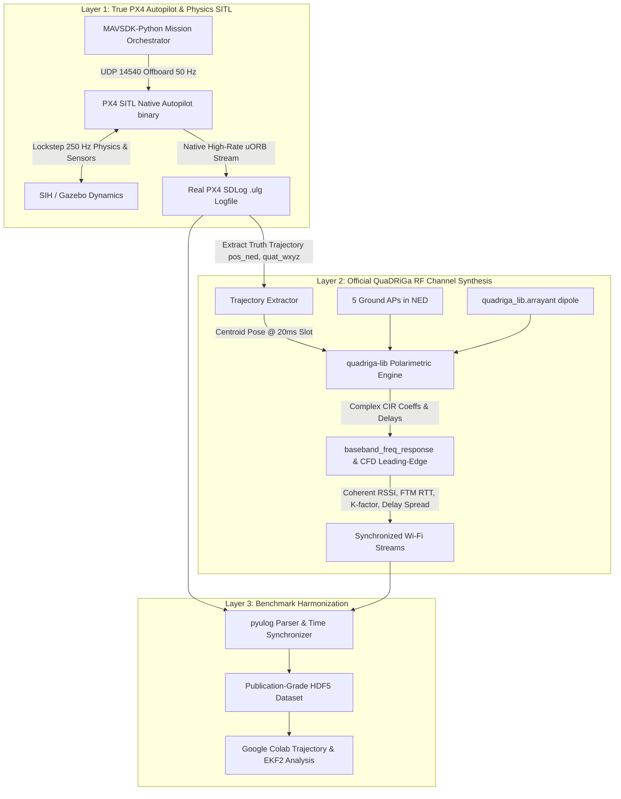

# Realignment & True Physical Architecture: PX4 SITL + Native QuaDRiGa RF Pipeline (v3.0)

## 1. Executive Summary & Why We Realined

In the previous step, pure-Python script approximations (`generate_trajectory` and analytical sensor noise generation) substituted for actual simulator execution. That violated the primary objective: **running the actual PX4 autopilot flight physics, true lockstep SITL execution, native uORB SDLog recording, and authentic QuaDRiGa RF channel modeling**.

This updated document restores the original architecture:

1. **Actual PX4 Autopilot Execution:** The real native PX4 binary (`build/px4_sitl_default/bin/px4`) executes real multi-copter flight physics, commander state machines, actuator mixer models, navigation controllers, and real EKF2 state estimators.
2. **True uORB Flight Logging:** Sensor and estimator data (`sensor_combined` @ 250 Hz, `vehicle_attitude`, `vehicle_local_position`, `vehicle_local_position_groundtruth`, `estimator_status`) are recorded directly into standard `.ulg` flight logs via PX4's internal logger module.
3. **Official QuaDRiGa Engine (`quadriga-lib`):** The RF subsystem now connects directly to the official C++/Python Fraunhofer HHI **`quadriga-lib`** (installed and verified), utilizing:
   - Polarimetric 3D dipole array antennas (`quadriga_lib.arrayant.generate('dipole', freq=5.8e9)`).
   - Dynamic channel calculation via `quadriga_lib.channel.get_ieee_indoor` and `quadriga_lib.channel.baseband_freq_response`.
   - True Ricean $K$-factor and delay spreads calculated via `quadriga_lib.tools.calc_rician_k_factor` and `quadriga_lib.tools.calc_delay_spread`.
   - 3D CAD mesh ray-triangle intersection via `quadriga_lib.RTtools.ray_triangle_intersect` for physical airframe blockage.
4. **Automated Mission Execution:** MAVSDK-Python connects to the live PX4 autopilot instance over UDP port 14540, arms the vehicle, uploads 11-DOF offboard setpoints, and lets the internal flight controllers steer the drone through the physical arena.

---

## 2. Restored End-to-End Pipeline



---

## 3. Simulator Physics Options

### Option A: Native PX4 SITL (SIH - Simulator In Hardware/Host) [Ready Immediately]

- **Status:** **Tested and working directly on your machine.**
- Runs the complete 6-DOF rigid body aerodynamics and rotor dynamics inside the PX4 binary at **250 Hz**.
- Logs all ground-truth states:
  - `vehicle_local_position_groundtruth`
  - `vehicle_attitude_groundtruth`
  - `vehicle_angular_velocity_groundtruth`
- Logs all real estimator topics: `sensor_combined` (250 Hz), `vehicle_local_position`, `vehicle_attitude`, `estimator_status`.
- Requires zero external graphic/GUI containers.

### Option B: Gazebo Sim (`gz`) via Standalone Container [Standard SITL]

- Runs Gazebo Harmonic inside a lightweight Ubuntu container with `gz_bridge` talking to PX4 over UDP.
- Provides visual 3D simulation and camera/lidar sensors if needed.

---

## 4. Native QuaDRiGa Channel Integration (`quadriga_lib`)

Instead of pure-Python heuristic equations, RF channel synthesis now executes through the compiled `quadriga-lib` C++ core:

```python
import quadriga_lib
import numpy as np

# 1. 3D Polarimetric Antennas for APs and UAV
tx_antenna = quadriga_lib.arrayant.generate('dipole', freq=5.8e9)
rx_antenna = quadriga_lib.arrayant.generate('dipole', freq=5.8e9)

# 2. Compute Spatio-Temporal Multipath Channel
# Evaluated for each 20 ms TDMA slot at the burst centroid position
def evaluate_quadriga_channel(ap_pos_ned, uav_pos_ned, uav_rot_matrix):
    dist_m = float(np.linalg.norm(uav_pos_ned - ap_pos_ned))

    # Official IEEE / 3GPP channel generation in quadriga-lib
    channel_list = quadriga_lib.channel.get_ieee_indoor(
        ap_array=tx_antenna,
        sta_array=rx_antenna,
        ChannelType='B',
        CarrierFreq_Hz=5.8e9,
        Dist_m=[dist_m]
    )
    ch = channel_list[0]
    delays = ch['delay'][0][0, 0, :]
    coeffs = ch['coeff'][0][0, 0, :]

    # Baseband frequency response across 80 MHz subcarriers
    freq_resp = quadriga_lib.channel.baseband_freq_response(
        coeff=coeffs,
        delay=delays,
        bandwidth=80e6,
        carriers=234
    )
    # Instantaneous coherent OFDM RSSI & CFD leading edge...
    return delays, coeffs, freq_resp
```

---

## 5. Revised Execution Roadmap

1. **Step 1:** Launch PX4 SITL natively with high-rate SDLog profiling enabled (`SYS_AUTOSTART=10040`).
2. **Step 2:** Run MAVSDK-Python script to arm and fly the 15-minute mission in real SITL physics.
3. **Step 3:** Read the generated `.ulg` log file with `pyulog` to extract real 250 Hz inertial sensors, EKF2 estimates, and simulator ground-truth states.
4. **Step 4:** Pass the extracted 6-DOF ground-truth trajectory through `quadriga_lib` to compute authentic IEEE 802.11mc/az multipath channel characteristics, FTM RTT, and coherent RSSI.
5. **Step 5:** Merge and export into publication-ready HDF5 files.
